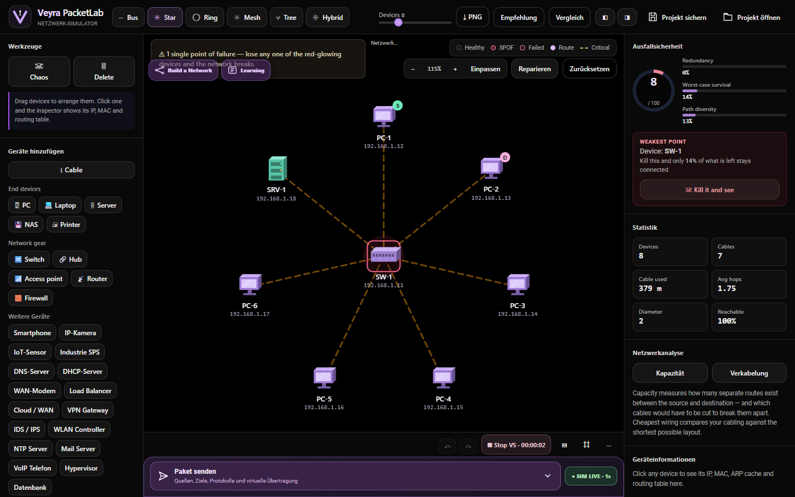
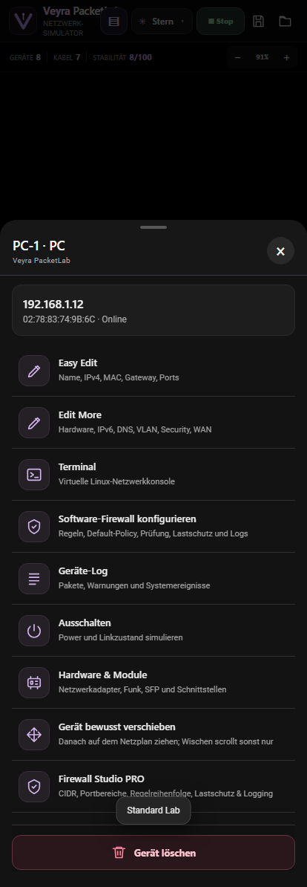
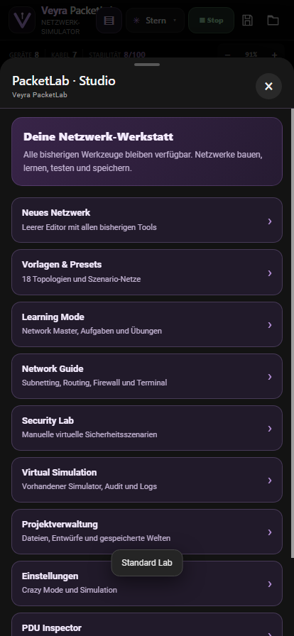
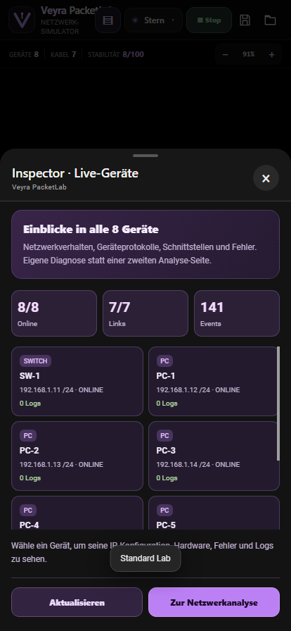
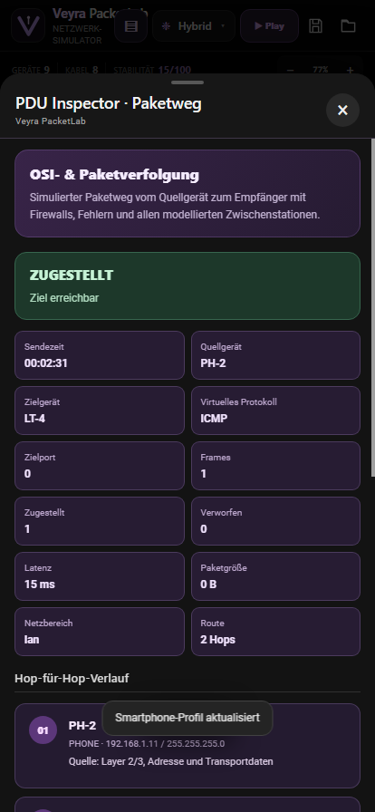
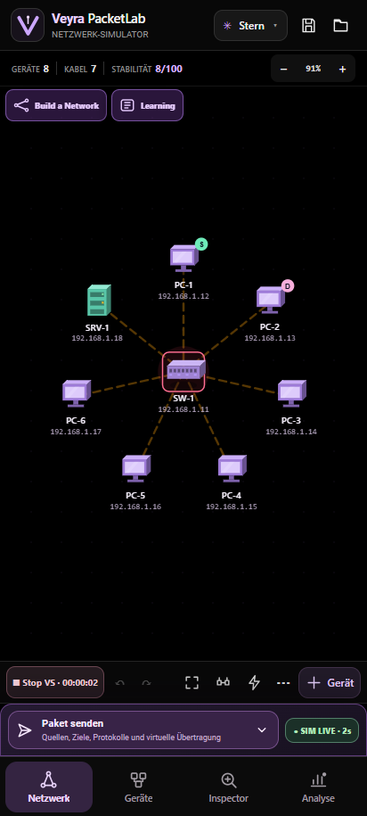
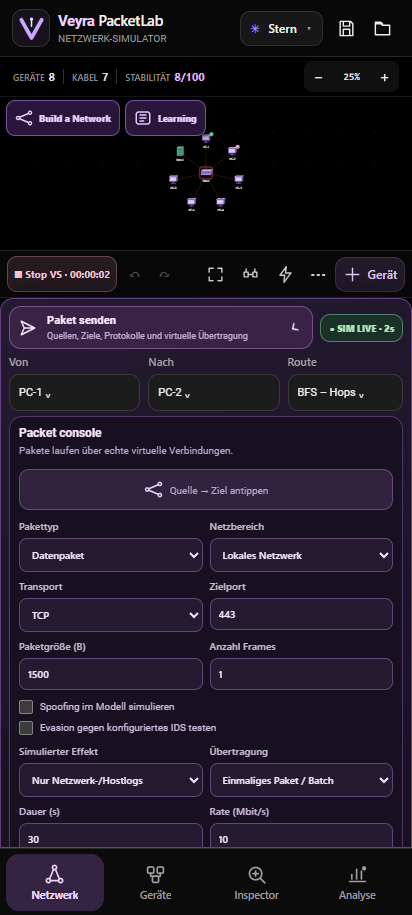
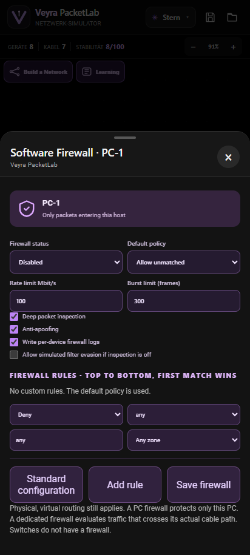
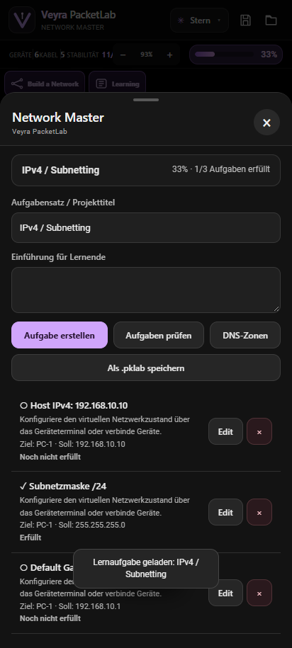

# PaketLab

### Veyra Network Simulation Studio · v0.7.1

**Netzwerke bauen. Pakete senden. Folgen verstehen.** 💜

[🌐 Website](https://ctrl-mietze.github.io/Packetlab/) · [📦 APK herunterladen](https://github.com/ctrl-mietze/Packetlab/releases/latest) · [🇬🇧 English](README.md) · [🛠 Fehler melden](https://github.com/ctrl-mietze/Packetlab/issues)

  

Echter Screenshot aus der laufenden v0.6.0-Simulation, keine erfundene Funktionsdarstellung.

---

> [!IMPORTANT]
> PaketLab ist ein **virtueller, lokaler Netzwerk-Simulator**. Router, PCs, virtuelle Exploits, Linux-/Cisco-Kommandos und Pakete werden modelliert. Es laufen keine echten IOS-Images, keine Linux-VMs und keine Angriffe auf reale Geräte oder Netzwerke. Ein simulierter Ausfall ist kein echter Geräteausfall.

## Bugfix v0.7.1 — Gerätemenüs

Die versehentlich erzeugten lila Rechtecke, doppelten Symbole und die farbige Umrandung der Software-Firewall wurden entfernt. Die Menüaktionen sind jetzt wieder einheitliche OLED-Zeilen wie Terminal und Geräte-Log. Alle Funktionen bleiben erhalten.

## Neu in v0.7.0

- Mobile Touch-Bedienung mit verbessertem Scrollen, Platzieren, bewusstem Verschieben und optionaler Serienplatzierung.
- 18 Netzvorlagen, Netzwerk-Studio, Guide mit Subnetzrechner und Topologiewahl beim Erstellen eigener Aufgaben.
- Getrennter Inspector und Analyse: Einzelgeräte, Logs und Hardware einerseits, Fehler, Statistik und Optimierung andererseits.
- PDU Inspector und Event Explorer: virtuelles Routing Hop für Hop, OSI-Einordnung, Filter und Ereignisprotokolle.
- Subnetz- und Gatewayprüfung, virtuelle Module für einzelne Gerätetypen, Smartphone-Profile mit Android/iOS sowie optionaler Crazy Mode.
- Firewall Studio PRO mit CIDR, Portbereichen, Regelreihenfolge, Rate-/Burst-Limits, Anti-Spoofing und Prüfprotokollen.
- Play/Stop rechts oben, direkt mehrfach sendbare Pakete auch bei geschlossener Konsole und ein Speichern-/Beenden-Dialog.
- Virtuelle Konsolenkommandos für mehrere OS-Modelle; keine echten Betriebssystem-Images, Angriffe oder Host-Root-Berechtigungen.

Alle bisherigen Werkzeuge bleiben erhalten. [Vergleich mit Cisco Packet Tracer 9](docs/CISCO_PACKET_TRACER_9_FEATURE_MATRIX.md) · [Release Notes](releases/v0.7.0.md)

<table>
<tr>
<td width="33%" align="center"><b>Studio & Presets</b></td>
<td width="33%" align="center"><b>Inspector</b></td>
<td width="33%" align="center"><b>PDU Inspector</b></td>
</tr>
</table>

## 💜 Willkommen bei PaketLab

PaketLab verbindet das freie Erstellen von Netzwerken mit echten **virtuellen Zustandsänderungen**. Kabel bestimmen den möglichen Paketweg, Router und VLAN-Konfigurationen entscheiden über Erreichbarkeit und Firewalls wenden ihre Regeln nur auf tatsächlich relevante Paketpfade an.

Mit v0.6.0 wurden vor allem folgende Bereiche verbessert:

- Der **Simulationskern** verarbeitet normale Pakete und Sicherheits-Pakete über denselben nachvollziehbaren Pfad.
- **Geräte-Logs** dokumentieren Zustellungen, Blockierungen, Firewall-Entscheidungen und simulierte Auswirkungen.
- **Build a Network** ermöglicht einen vollständig leeren Netzplan.
- Die neue **einklappbare Paketkonsole** erlaubt konfigurierte Pakete und zwei Taps auf Quelle/Ziel im Canvas.
- **Learning Mode** ermöglicht den bewussten Wechsel mit Speichern oder Verwerfen sowie vordefinierten Aufgaben.
- **Network Master** bewertet Aufgaben in Prozent und setzt bevorzugt auf Terminalkonfiguration.
- **Firewall Studio** trennt Host-/Software-Firewalls und dedizierte Netzwerk-Firewalls korrekt.
- **Long Transfers** modellieren Uploads/Downloads mit Datenrate, Dauer und Fortschritt.
- Der Hoch-/Querformat-Aufbau wurde verbessert; die bisherigen Werkzeuge und TopoLab-Algorithmen bleiben enthalten.

## 📥 Download

**[PaketLab 0.7.1 — Android-APK herunterladen](https://github.com/ctrl-mietze/Packetlab/releases/download/v0.7.1/PacketLab-v0.7.1-Android.apk)**

| Angabe | Wert |
| :-- | :-- |
| Anwendung | PaketLab / Veyra PacketLab |
| Paket-ID | \`ctrl.mietze.veyrapacketlab\` |
| Version | \`0.6.0\` |
| Plattform | Android 10 oder neuer |
| Download | [GitHub Release v0.7.1](https://github.com/ctrl-mietze/Packetlab/releases/tag/v0.7.1) |
| Prüfsummen | \`SHA256SUMS.txt\` im Release |

Wenn eine selbst erstellte APK anders signiert ist als die bisher installierte App, lässt Android kein direktes Update zu. Vor einer Deinstallation unbedingt \`.pklab\`-Projekte und relevante App-Daten sichern.

## 📸 Screenshots

<table>
<tr>
<td width="25%" align="center"> <b>Netzwerk</b></td>
<td width="25%" align="center"> <b>Paketkonsole</b></td>
<td width="25%" align="center"> <b>Firewall</b></td>
<td width="25%" align="center"> <b>Learning</b></td>
</tr>
</table>

### Build a Network

Der freie Netzwerkeditor startet **ohne automatisch platzierte Geräte**. PCs, Laptops, Server, Router, Switche, Firewalls, Access Points und viele weitere Geräte kannst du aus der bestehenden Bibliothek einfügen und anschließend per Kabel verbinden.

Die bisherigen Topologien Bus, Stern, Ring, Mesh, Baum und Hybrid sowie weitere Presets bleiben erhalten. Kabel können weiterhin per Touch und Listen-Auswahl gelegt werden.

### Paketkonsole

Ein kompakter Button öffnet die erweiterten Packet-Controls. Du kannst:

- Quelle und Ziel auswählen – auch direkt **Quelle antippen, Ziel antippen** auf dem Netzplan.
- IPv4-/Protokollmodelle wie ICMP, DNS, TCP, UDP, HTTP, HTTPS und SSH nutzen.
- Ports, Paketgrößen und Frame-Anzahlen festlegen.
- Zwischen **Local Network** und konfiguriertem virtuellem **Internet/WAN** unterscheiden.
- Virtuelle Spoofing-/Evasion-Versuche kennzeichnen.
- Optional modellierte Geräte-Beeinträchtigungen oder Ausfälle auslösen.
- Lang laufende Upload-/Download-Transfers erstellen.
- Nach dem Senden die Zustellungs- und Blockierungsgründe nachlesen.

**Wichtig:** Ein normales Datenpaket schaltet niemals ohne Grund ein Gerät aus. Nur bewusst gewählte virtuelle Szenarioeffekte können einen Offline-Status simulieren.

### Firewall: Host ist nicht gleich Netzwerk

Die Firewall an einem **PC oder Server** filtert zunächst ausschließlich diesen Host. Sie gilt nicht automatisch für jedes andere Gerät im Netzwerk.

Eine **dedizierte Firewall** wirkt nur, wenn die virtuelle Route tatsächlich durch dieses Gerät führt. Ein Switch ist in diesem Modell kein Ersatz für eine dedizierte Firewall.

Im Firewall Studio sind unter anderem Default-Allow/-Deny, Regelreihenfolge, Protokoll/Port, LAN/WAN, Anti-Spoofing, Inspektion, Rate-/Burst-Limits und Logging konfigurierbar. Die Funktionen sind Simulationen, keine Kernel-Firewall auf deinem Android-Handy.

Zusätzliche virtuelle Terminalbefehle:

\`\`\`text
firewall status
firewall enable
firewall default deny
firewall allow tcp 443
firewall deny udp 53
firewall log
firewall reset
\`\`\`

Auch beim Senden aus dem ursprünglichen Vurnabil-Paketmenü verwendet v0.6.0 den gemeinsamen simulierten Paketpfad.

## 🎓 Learning Mode und Network Master

Beim Betreten des Learning Mode wird zunächst gefragt, was mit deinem bisherigen Netzplan geschehen soll:

- Als **\`.pklab\` exportieren**.
- Als **lokalen Entwurf sichern**.
- Den bisherigen Stand **ohne neue Sicherung verwerfen**.

Danach kannst du eine vorhandene \`.pklab\` öffnen, lokale Projekte laden, eine neue Aufgabe erstellen oder aus Lernvorlagen wählen.

### Vorhandene Lernvorlagen

| Aufgabe | Lernziel |
| :-- | :-- |
| IPv4 / Subnetting | IPv4-Adresse, Maske, Gateway |
| IPv6 / SLAAC | IPv6-Adressen und Verbindungen |
| DNS | Resolver und DNS-Records |
| Topologie bauen | Leeres Lab selbst verkabeln |
| Routing & VLAN | Gateway, geroutete Pfade, VLAN |
| Firewall & Security | Policies und Hardening |
| Campus Challenge | Größerer, kombinierter Netzplan |
| WAN & Internet | Konfigurierter Internet-Uplink |
| Datentransfer & QoS | Langzeitübertragung und Analyse |

Die Fortschrittsanzeige wertet den **aktuellen virtuellen Zustand** aus und zeigt einen Prozentwert. Das Erfüllen einer Aufgabe hängt nicht bloß von Klicks ab.

**Network Master:** Easy Edit und Edit More werden ausgeblendet. Konfigurationen erfolgen möglichst über die virtuelle Gerätekonsole. Terminal, Geräte-Logs und Geräteverwaltung bleiben verfügbar.

**Standard Lab:** Easy Edit, Edit More und alle bisherigen Funktionen bleiben erhalten. Zusätzlich gibt es das Firewall-Konfigurationsmenü.

### \`.pklab\`-Kompatibilität

Das Projektformat speichert den Netzplan, Gerätekonfigurationen, Simulationsparameter, Aufgaben und den Modus \`standard\` oder \`master\`. Standard-Labs lassen sich über denselben Projektmanager wieder öffnen. Beim Laden wird der gespeicherte Modus wiederhergestellt.

## ⚙️ Simulation und Logs

PaketLab startet die virtuelle Simulation automatisch. Über **Pause / Resume** kannst du den Simulationszeitgeber anhalten oder fortsetzen.

ARP-/DHCP-ähnliche Prozesse können durch den Zustand der virtuellen Geräte ausgelöst werden. Der Simulator erfindet nicht einfach bei jedem Zeittakt willkürliche Pakete. Konfigurierte Transfers werden nur bei laufender Simulation fortgeschrieben.

Die neue Engine zeichnet auf:

- den Sender, Empfänger und betroffene Zwischenstationen,
- akzeptierte oder blockierte Pakete,
- Firewall-Regeln und Ablehnungsgründe,
- Zustellungszahlen und simulierte Paketverluste,
- Sicherheitsereignisse und virtuelle Befallszustände,
- abgeschlossene oder unterbrochene Transfers.

**WAN funktioniert nur mit einem konfigurierten, verbundenen virtuellen Internet-Uplink.** Ohne ein solches Modell bleibt der Netzplan auf LAN-Kommunikation begrenzt.

## 🧠 Was von TopoLab erhalten bleibt

Die ursprünglichen Graphalgorithmen, Renderer, Topologie-Generatoren, Gerätedarstellungen und weitere Bestandteile sind weiterhin im Source. Dazu gehören BFS, Dijkstra, Tarjan, Edmonds-Karp, Kruskal und die ursprüngliche Ausfallsicherheitsanalyse.

Eine Originalkopie liegt zudem unter [\`upstream/TopoLab/\`](upstream/TopoLab/). Die Attribution und TopoLab-Verweise werden nicht aus dem Projekt entfernt.

## ✅ Getestet

| Tests | Ergebnis |
| :-- | :-- |
| Ursprüngliche Kernmodell-Tests | 12 bestanden |
| Neue v0.6-Paket-/Firewall-/Transfer-Tests | 18 bestanden |
| UI-/Responsiveness-Tests | 35 bestanden |
| Touch-Endpunktauswahl und Firewall-Interaktionen | 15 bestanden |
| Android-Debug-Build | Erfolgreich |

Das ersetzt keine vollständigen Langzeittests auf allen Android-Geräten, WLAN-Umgebungen oder Firmwareständen.

## 🛠 Selbst bauen

Benötigt: JDK 17, Android SDK 35 und Gradle Wrapper.

Unter Windows:

\`\`\`powershell
git clone https://github.com/ctrl-mietze/Packetlab.git
cd Packetlab
.\gradlew.bat :app:assembleDebug
\`\`\`

Ausgabe: \`app/build/outputs/apk/debug/app-debug.apk\`

Kernmodelltests:

\`\`\`powershell
node tests_packetlab_core.js
node tests_packetlab_v06.js
\`\`\`

UI-Smoke-Tests benötigen Python/Playwright und Edge Chromium:

\`\`\`powershell
python smoke_v06.py
python smoke_v06_extended.py
\`\`\`

## 🔐 Sicherheit & Datenschutz

PaketLab führt keine virtuellen Pakete auf echten Netzwerkschnittstellen aus, verteilt keine echten Exploits und öffnet keine fremden Rechner. Kommandos bearbeiten ausschließlich simulierte Profile. Projekte und Entwürfe werden lokal gespeichert beziehungsweise explizit exportiert.

Wenn du einen Fehler meldest, entferne bitte private IP-Adressen, persönliche Daten oder Netzwerkzugangsdaten aus den bereitgestellten Logs.

## 🗺️ Nächste Schritte

- [ ] Weitere reproduzierbare TCP-/IPv6-Modelltests.
- [ ] Größere interaktive Lernsets und Lehrmaterialien.
- [ ] Weitere graphische Firewall- und NAT-Funktionen.
- [ ] Virtuelles Packet-Capture-Exportformat.
- [ ] Verbesserte Orientierungstests auf vielen Displaygrößen.
- [ ] CI-gestützter und reproduzierbarer Build-/Release-Prozess.

Weitere Einzelheiten stehen in der [englischen Dokumentation](README.md) und auf der [Projektwebsite](https://ctrl-mietze.github.io/Packetlab/).

## ⚖ Projektursprung

<strong>▾ TopoLab – Ursprung und Credits anzeigen</strong>

**Originalprojekt:** [TopoLab von Vansh Bhardwaj](https://github.com/vansh231205/TopoLab).

PaketLab verwendet Bestandteile der ursprünglichen TopoLab-Topologie- und Netzwerk-Analyseengine. Kommentare, Algorithmen, Herkunftsinformationen und der ursprüngliche Projektstand bleiben erhalten. Der Original-Source ist unter [\`upstream/TopoLab/\`](upstream/TopoLab/) enthalten.

Das öffentliche TopoLab-Repository enthält derzeit keine eindeutige SPDX-Lizenzdatei. Daraus folgt nicht automatisch, dass fremde Personen die Originalbestandteile beliebig weiterverwenden oder selbst neu lizenzieren dürfen. Die Rechte des Originalautors bleiben bestehen.

---

**PaketLab · by Veyra**

*Ein Netzwerk, tausend Dinge, die man lernen kann.*

[⬆ Nach oben](#paketlab)

