

# PacketLab

### Veyra Network Simulation Studio · v0.10.0

**Build a Network. Send packets. Understand the consequences.**

[🌐 Website](https://ctrl-mietze.github.io/Packetlab/) · [⬇ Android APK](https://github.com/ctrl-mietze/Packetlab/releases/latest) · [🇩🇪 Deutsche README](README.de.md) · [🛠 Issues](https://github.com/ctrl-mietze/Packetlab/issues)

  

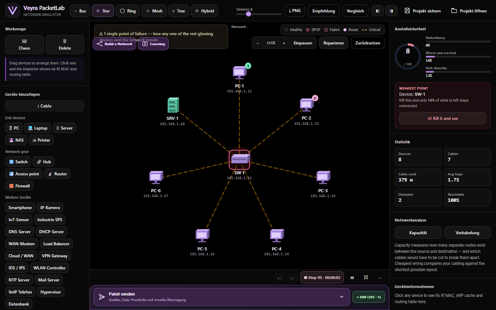

Real browser screenshot of the Android application's bundled interface. All topology tools are part of the simulator.

---

> [!IMPORTANT]
> PacketLab is an **offline virtual network simulator**. Its hosts, routers, services, vulnerability tests, CLI, firewalls and packets are **models**, not actual Linux VMs, Cisco IOS binaries or Internet connections. Threat, spoofing, firewall bypass, traffic flood, outage and simulated compromise features never send real attacks or change any external devices.

## PacketLab v0.10.0 — Net@Lab V2 Interactive Academy

The Net@Lab network handbook is now a truly interactive VeyraLabs learning experience: **62 full-length German chapters**, categorized navigation, readable lessons, search, bookmarks, learning goals, curated visuals, device inspection and animated step-by-step packet-path selection.

Every chapter features a self-contained educational network. Select a PC, router, server or switch to inspect its **read-only** IPv4/IPv6 addresses, subnet, gateway, MAC, interface, service, firewall and event data. Select "Mein Lab" to inspect the existing virtual PacketLab graph without changing it.

[Net@Lab V2 technical documentation](docs/NETATLAB_V2.md) · [Release notes](releases/v0.10.0.md)

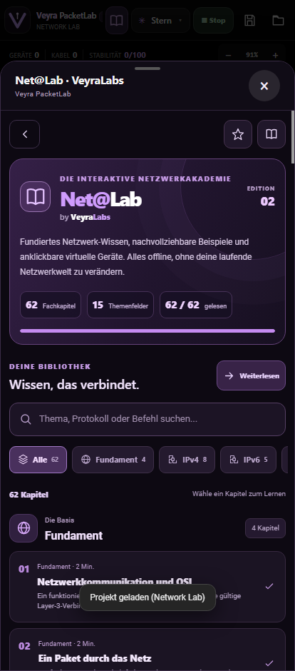
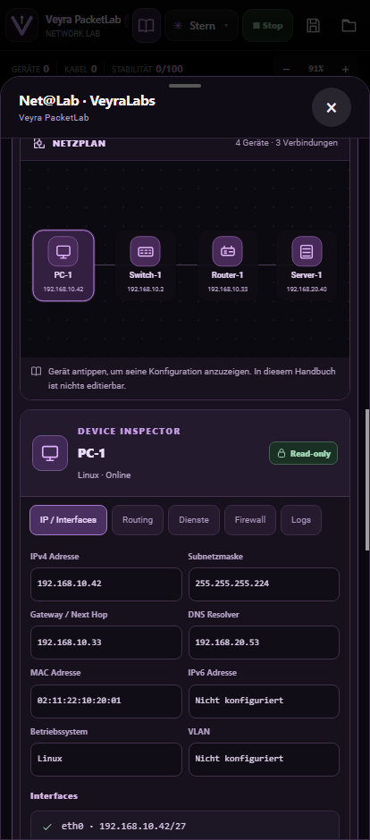

## PacketLab v0.9.0 — Network Lab, Training and Net@Lab

Three workspaces and separate local libraries: **Network Lab** (free simulated topology), **Network Training Builder** (author multi-level learning tasks) and **Network Lab Training** (play read-only-in-UI .worklab challenges and grade results). The builder exports both editable .pklab projects and .worklab start snapshots with goals.

**Net@Lab by VeyraLabs** includes 62 original searchable offline chapters with bookmarks covering IPv4 and IPv6, subnetting, Linux, Windows, routing, switching, server services, firewalls and troubleshooting.

The new Packet Composer uses one Veyra styled selection interface rather than a native Android radio-choice popup. Firewall editor, Inspector, Analysis, building floors and press-and-hold Quick Edit have been reorganized. The opt-in Building Agent asks Android for local Wi-Fi information and mDNS services only when explicitly started; it is available in the free Network Lab only.

The existing graph engine, package ID and .pklab format remain compatible. This is an educational network simulator, not full Cisco IOS, Windows or Linux emulation.

[Release notes](releases/v0.9.0.md)

<table><tr><td width="33%">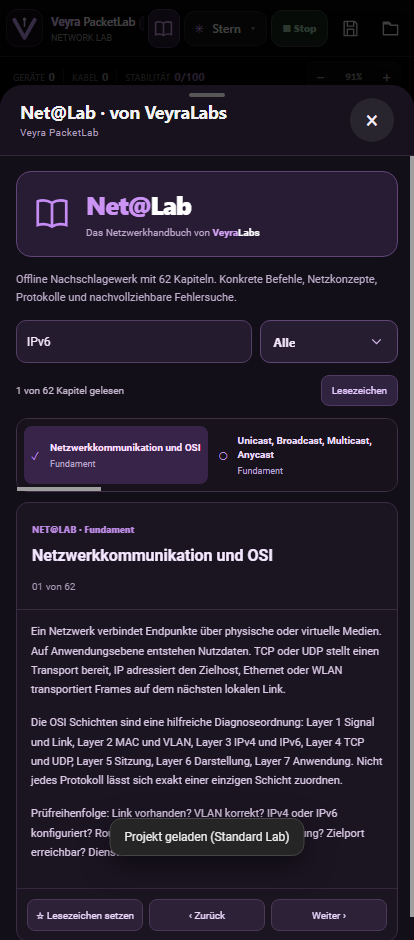</td><td width="33%">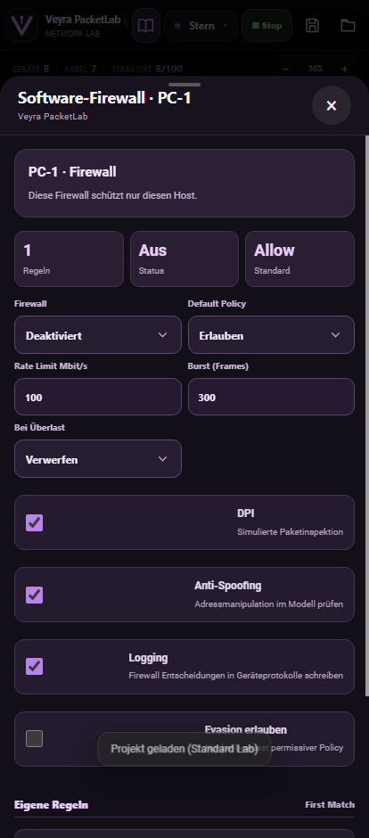</td><td width="33%">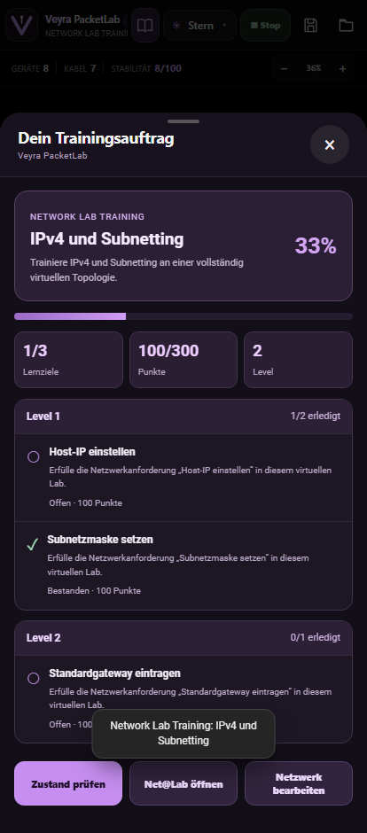</td></tr></table>

## v0.8.0 — Unified OLED Studio & Virtual Operating Systems

This release redesigns the device menu around one self-contained Android OLED component, with no legacy CSS-decorator interference. It adds per-device OS selection and a virtual Linux/Windows/Android/iOS/Cisco terminal with bounded files, folders, service state, command history, startup configurations and project-file persistence.

Existing networking, firewalls, presets, inspect/analysis tools, learning mode and world files remain available. The virtual OS commands never execute on the Android host.

[Virtual OS documentation](docs/VIRTUAL_OS_AND_DESIGN_V08.md) · [v0.8.0 Release Notes](releases/v0.8.0.md)

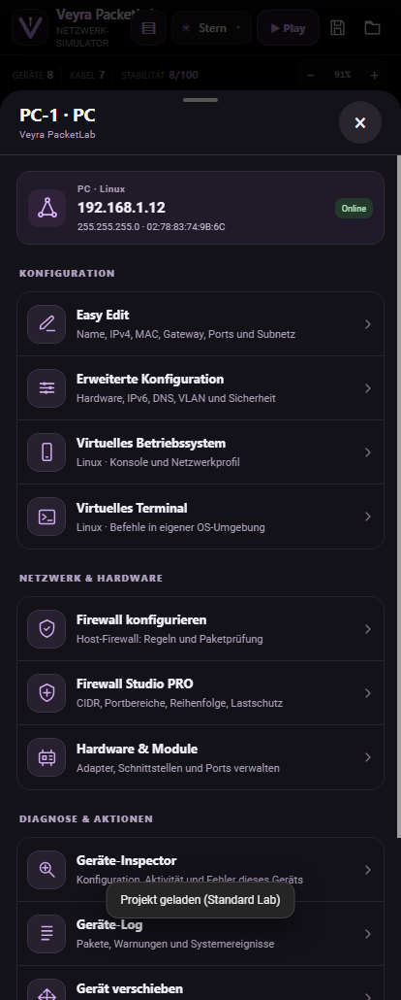 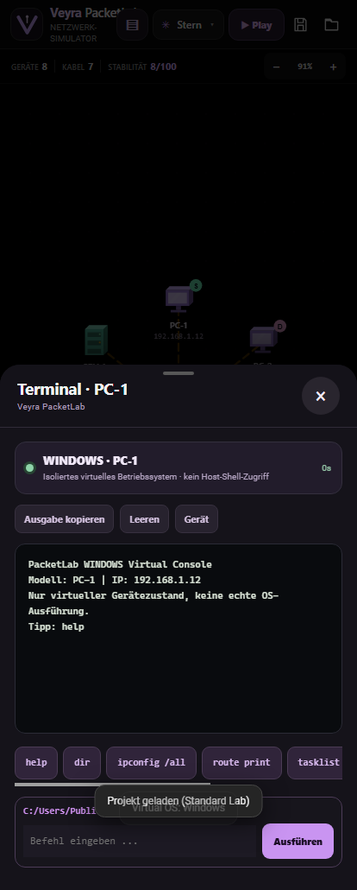

## v0.7.1 — Device menu hotfix

The device menu now uses consistent OLED list rows. Removed the unintended violet tiles, double icons and the colored Software Firewall outline. Existing device actions and all simulator functions remain available.

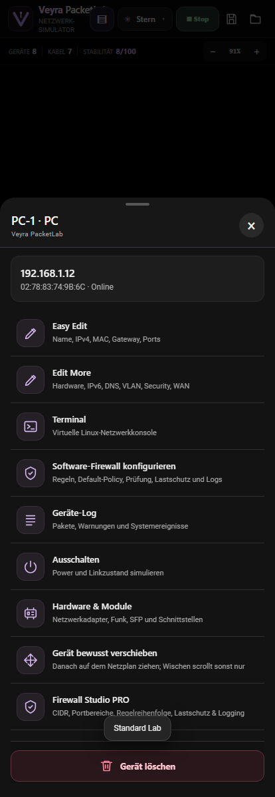

## New in v0.7.0

PacketLab adds a touch-first editor, deliberate device movement, 18 curated topology presets, a Network Guide with IPv4 subnet calculator, detailed per-device Inspector, diagnostic Analysis, PDU hop/OSI Inspector and event explorer. Device-specific modules, virtual Android/iOS and IOS/Windows terminals, expanded CIDR/port-range firewall rules and a safer Android exit menu are included.

Basic traffic is simulated locally; security scenarios only run on explicit user action. Older features and .pklab v3 compatibility are preserved.

[Feature comparison with Cisco Packet Tracer 9](docs/CISCO_PACKET_TRACER_9_FEATURE_MATRIX.md) · [Release notes](releases/v0.7.0.md)

<table>
<tr>
<td width="33%" align="center">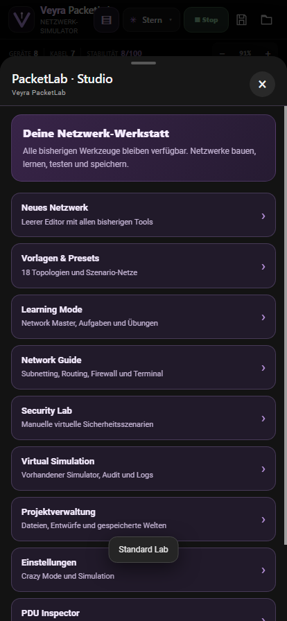<b>Studio & Presets</b></td>
<td width="33%" align="center">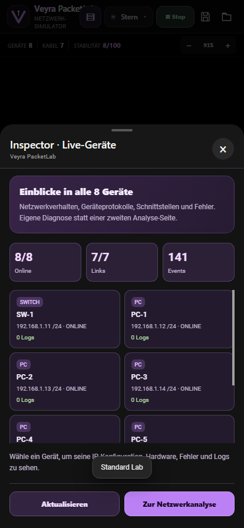<b>Inspector</b></td>
<td width="33%" align="center">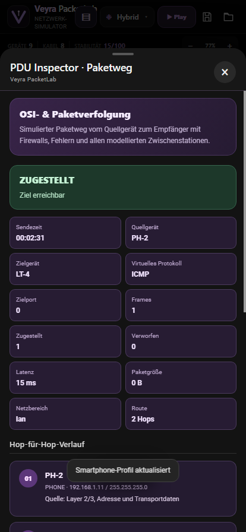<b>PDU Inspector</b></td>
</tr>
</table>

## Welcome to PacketLab 💜

**PacketLab** is a hands-on computer networking studio designed to make more of the packet journey visible: you can build a topology, wire devices, configure simulated network systems, generate traffic, inspect what traversed each node and see why a firewall, route or host accepted or blocked it.

The project retains the familiar core of its existing TopoLab-based graph editor while expanding the learning and device model. It is not just a drawing editor: packets and constraints are calculated against virtual links and device properties. It also isn't a complete hardware emulator, and doesn't pretend to be one.

### Why v0.6.0?

This release concentrates on **trustworthy simulation behavior**, **mobile usability**, **freeform building**, **educational tasks** and **consistent packet event reporting**. Older functions remain available; v0.6.0 adds new components rather than replacing the established TopoLab graph engine.

## 📦 Download

| Android | Details |
| :-- | :-- |
| **Current** | **PacketLab v0.10.0** |
| **Package** | \`ctrl.mietze.veyrapacketlab\` |
| **Platform** | Android 10+ (\`minSdk 29\`) |
| **Format** | Installable APK |
| **Where** | [GitHub Release v0.10.0](https://github.com/ctrl-mietze/Packetlab/releases/tag/v0.10.0) |
| **Direct APK** | [PacketLab-v0.10.0-Android.apk](https://github.com/ctrl-mietze/Packetlab/releases/download/v0.10.0/PacketLab-v0.10.0-Android.apk) |

Release assets include **\`SHA256SUMS.txt\`** to verify that your download matches the published file.

> If a local build uses a different Android signing key than your installed build, Android will reject an in-place update. Back up your .pklab projects and app data before attempting to switch signatures.

## 🎬 Inside the app

<table>
<tr>
<td width="25%" align="center">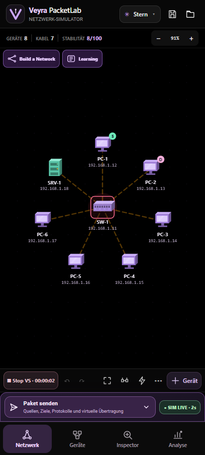 <b>Network workspace</b></td>
<td width="25%" align="center">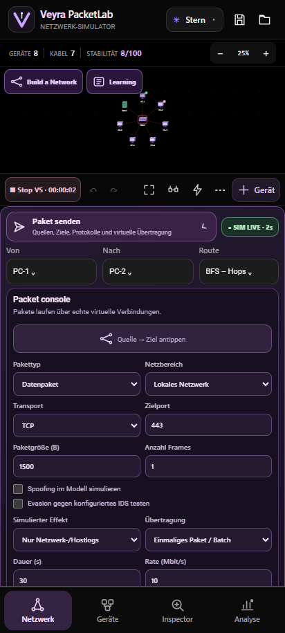 <b>Packet Console</b></td>
<td width="25%" align="center">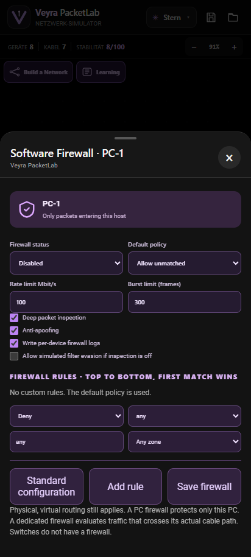 <b>Firewall editor</b></td>
<td width="25%" align="center">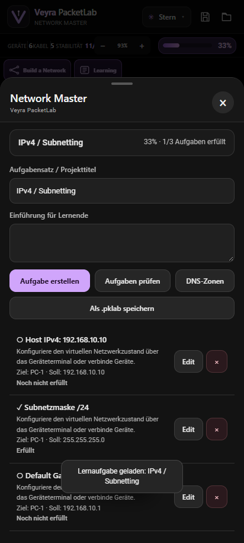 <b>Network Master</b></td>
</tr>
</table>

*Images captured from the running v0.6 interface, not speculative mockups.*

### Two ways to learn

**Standard Lab** is the free simulator with all your familiar tools: drag and connect nodes, Easy Edit, Edit More, terminal, network analysis, live packet animation, PNG export and TopoLab-style graph diagnostics.

**Learning / Network Master** is the task-driven environment. Before entering, you can save the current workspace to a \`.pklab\` file, keep a draft locally or discard it. The previous topology is then cleared for the new exercise.

Learning Mode emphasizes **CLI-driven configuration**, with Easy Edit / Edit More intentionally removed from device menus. Devices still provide a terminal, events and power state. A grading bar shows the percentage of tasks currently satisfied by the virtual network.

## 🧩 1. Build a Network — start with nothing

Tap **Build a Network** to start a genuinely empty topology. No router, switch, PC or cable is auto-inserted. Add devices from the existing catalog and place them where you like.

Available device types include, among others:

| End systems | Infrastructure | Services / specialized |
| :-- | :-- | :-- |
| PC, Laptop | Switch, Hub, Router | DNS, DHCP, NTP |
| Server, NAS | Access Point, Wi-Fi Controller | Database, Load Balancer |
| Printer, Phone | Dedicated Firewall | Mail, VoIP, Hypervisor |
| Camera, IoT, PLC | Modem, VPN, IDS | Cloud endpoint |

Cable placement supports the existing **two-tap wiring** and list-assisted selection, plus the original desktop pointer workflow. Cable models track mediums such as Cat6, Cat6A, fiber, coax, Wi-Fi and virtual VPN tunnels. Cable metrics affect the simulated bandwidth, reach, loss and latency.

Already have a project? Your existing local draft workflow remains available, and you can explicitly export a \`.pklab\` before starting again.

## 📡 2. Packet Console — one consistent delivery path

A compact bottom bar stays folded until needed. Expand it to choose packet properties without permanently losing screen space.

New in v0.6:

- Foldable packet composer with a readable mobile and landscape layout.
- **Tap source → tap destination** directly on the network map. The full canvas becomes available while picking and the composer returns afterwards.
- Configure protocol, destination port, payload size (bounded), frame count (bounded), local LAN vs. virtual Internet/WAN and the selected packet type.
- Regular packets: ICMP, ARP-related workflows, DNS, TCP, UDP, HTTP, HTTPS, SSH and ordinary data.
- Simulated security packets: web-input manipulation, DNS spoofing model, SMB worm, IoT botnet, auth probes, traffic flood and other existing vulnerability profiles.
- Optional flags for simulated spoofing and evasion attempts.
- Optional *explicit* impact behavior (degradation or virtual target outage); normal packets never switch a device off.
- Long virtual **upload/download** transfers with configured rate, duration, progress and per-device transfer events.
- The original packet browser and vulnerability menu continue to use the common virtual delivery engine.

**What does a simulated packet do?**

The model inspects the configured source/destination, active cable path, subnet/VLAN/routing constraints, host firewall and dedicated routed firewall policies. An accepted packet updates counters and logs on involved devices. A dropped packet creates a reasoned blocked event. Certain vulnerability profiles can produce virtual *infection*, *mitigation*, *degradation* or *outage* states according to the selected scenario and target configuration. Nothing executes as malware.

## 🔥 3. Firewall Studio — host and network security are different

PacketLab deliberately distinguishes three kinds of equipment:

**Software firewall (PC/server/end device):** filters traffic delivered **to that specific host**. Activating a firewall on one PC does not make it a global network firewall.

**Dedicated network firewall:** evaluates traffic **only when it traverses the actual configured device in the virtual graph**. A packet traveling on a different physical path does not inherit that firewall's rules.

**Switches/hubs:** do not magically become stateful network firewalls. Their original switching and topology roles remain separate from security gateways.

### Configurable properties

| Setting | Purpose |
| :-- | :-- |
| Enabled/disabled | Turn that virtual firewall on or off |
| Default policy | Allow or deny unmatched inbound/crossing traffic |
| Ordered rules | Allow, deny or log per protocol/port and LAN/WAN scope |
| Anti-spoofing | Detect and reject packets with modeled spoof markers |
| Inspection | Simulated deep-inspection flag |
| Simulated evasion | Only evaluates according to intentionally permissive model configuration |
| Rate / burst limits | Detect high-load traffic and apply configured drop behavior |
| Device logging | Record firewall decisions at the firewall, source and destination |

**Standard configuration** provides a safe and understandable starting policy; custom rules are opt-in.

The virtual CLI also offers commands such as:

\`\`\`text
firewall status
firewall enable
firewall default deny
firewall allow tcp 443
firewall deny udp 53
firewall log
firewall reset
\`\`\`

These commands modify the local simulation profile and are **not executed on Linux, Windows, Cisco hardware or any outside device**.

## 🧪 4. Learning Mode — from exercises to progress tracking

Learning Mode is a separate workspace transition. Before clearing the visible graph, choose one of:

- **Save .pklab** to the device.
- **Save local draft** to the app.
- **Discard unsaved graph** and proceed without keeping a new draft.

Then select:

- Create a new, empty Network Master exercise.
- Import an existing \`.pklab\` from a file.
- Restore a locally saved project.
- Load one of the learning presets.

### Included exercise starters

| Exercise | Skills |
| :-- | :-- |
| IPv4 / Subnetting | IPv4 address, mask, gateway |
| IPv6 / SLAAC | Addresses/prefixes and connected hosts |
| DNS | Resolver and DNS records |
| Topology building | Place devices and create physical links |
| Routing / VLAN | Gateway, routed path and VLAN assignment |
| Firewall / security | Host policy, hardening and configuration |
| Campus Challenge | Larger multi-device network with combined tasks |
| WAN / Internet | Configure network gateway/uplink |
| Data transfer & QoS | Observe long simulated file transfers and reachability |

Task evaluation reads **actual modeled state** rather than awarding points for simply pressing buttons. It grades device configuration, topology conditions, reachable routes, saved DNS records, firewall status and completed transfers. Progress appears in percent and can be preserved via \`.pklab\`.

### Learning projects are still .pklab files

PacketLab preserves the original project wrapper and extends its studio metadata. The serialized file contains the graph, mode (\`standard\` or \`master\`), task definitions, DNS records, logs and various virtual device configurations.

Users can load standard projects within the same project system; loading restores the mode indicated by the file. Legacy project support remains in the existing loader.

## 🔌 5. Virtual systems & the terminal

The built-in terminal and Edit More profile fields support simulated device configuration for:

- IPv4 and IPv6, subnet mask, default route, static routes and DNS resolver.
- Basic DHCP and DNS service behavior.
- VLAN, interface/port state, and modeled bandwidth.
- Hardware profile values such as CPU, RAM, disk and MTU.
- Host and network firewall decisions.
- Virtual service management and diagnostic commands.

The terminal command names resemble familiar Linux networking tools, but the output represents **the simulated device's stored configuration**, not a real Linux network namespace.

### Separate LAN and WAN models

**LAN** packets can work fully offline when a physical virtual path and relevant configuration exist.

**WAN/Internet** scenarios require a configured, connected virtual uplink. Setting an Internet flag on a disconnected host isn't enough to create a route. No real Internet is accessed by the lab.

## 🧠 6. Simulation model and original TopoLab algorithms

The original graph engine remains in the project. It includes classic graph algorithms:

- **BFS** shortest-hop routing.
- **Dijkstra** minimum-cost routing.
- **Tarjan** articulation-point/bridge detection.
- **Edmonds–Karp** maximum-flow/min-cut analysis.
- **Kruskal** minimum-spanning tree analysis.
- Live graph connectivity and resilience scoring.

PacketLab adds virtual profiles, packet evaluation, firewall rules, simulated vulnerabilities, learning progress and event logs around the original topology model.

### Simulation starts automatically

The simulation clock is active by default, with a **Pause / Resume** control.

Automatic clock ticks can advance boot/ARP/DHCP-like states and active transfers. The simulator does **not** secretly generate arbitrary user traffic every few seconds. Optional background traffic remains configurable. A paused simulation does not advance transfer time.

## 🧾 7. Logs: prove the packet arrived, was blocked, or changed state

A single operation can produce correlated records across:

- Network-wide event log.
- Source device log.
- Destination device log.
- Firewall/security checkpoint(s) actually crossed.
- Virtual transfer session and diagnostic result.

Logs capture decisions such as **DROP**, **BLOCK**, accepted **FLOW**, virtual malware mitigation, dependency failures and transfer completion. This is an educational event model, not pcap capture of actual network traffic.

## 📱 8. UI and screen rotation

v0.6 refines the existing OLED-style Veyra interface rather than replacing it with an unrelated dashboard.

- Compact, always-reachable **Build a Network** and **Learning** controls.
- A collapsed packet bar that doesn't steal canvas height until opened.
- Two-tap packet endpoint selection on the main canvas.
- Designed for portrait, landscape and desktop-sized development preview.
- Retains original toolbar, device catalog, graph editor, analysis screens and TopoLab topology presets.
- TopoLab credits remain in the application as a **collapsed disclosure**, rather than deleting project history or silently replacing attribution.

Screenshots are included in [\`docs/assets/\`](docs/assets/).

## ✅ Tests & verification

| Suite | Outcome |
| :-- | :-- |
| Original pure virtual network model | 12/12 passed |
| New packet/firewall/flow model | 18/18 passed |
| Android WebView/browser functional & responsive smoke tests | 35/35 passed |
| Additional touch-picking and firewall integration smoke tests | 15/15 passed |
| Android Gradle debug build | Successful |
| Test safety scope | Local virtual network; no real attacks or external host interaction |

Manual device-specific testing remains valuable, particularly for vendor UI skins, display cutouts, orientation changes, huge topology graphs and older saved project files.

## 🛠 Build from source

### Requirements

- Android SDK 35 (including build tools)
- JDK 17
- Gradle Wrapper (included)
- Windows for the bundled \`gradlew.bat\`; another Gradle-compatible environment can also build the Android project.
- Node.js 20+ for the pure JavaScript model tests.
- Optional Playwright Python package + Edge Chromium for UI smoke tests.

### Build Android APK

\`\`\`powershell
git clone https://github.com/ctrl-mietze/Packetlab.git
cd Packetlab

.\gradlew.bat :app:assembleDebug
\`\`\`

Expected artifact:

\`\`\`text
app/build/outputs/apk/debug/app-debug.apk
\`\`\`

Your local Android debug-signing certificate may differ from the official published build.

### Run model tests

\`\`\`powershell
node tests_packetlab_core.js
node tests_packetlab_v06.js
\`\`\`

### Optional UI smoke tests

\`\`\`powershell
python -m pip install playwright
python -m playwright install chromium
python smoke_v06.py
python smoke_v06_extended.py
\`\`\`

The scripts use Edge/Chromium in a local test context; they do not contact external lab endpoints.

## 🗂 Repository map

\`\`\`text
Packetlab/
├── app/
│   └── src/main/
│       ├── assets/
│       │   ├── index.html
│       │   ├── styles.css / veyra.css
│       │   ├── packetlab-v06.css
│       │   └── js/
│       │       ├── graph.js / topologies.js / render.js
│       │       ├── app.js / sim.js
│       │       ├── packetlab-core.js
│       │       ├── packetlab-next.js
│       │       ├── packetlab-terminal-v05.js
│       │       ├── packetlab-v06-engine.js
│       │       └── packetlab-v06.js
│       └── java/                  # Native Android WebView bridge
├── gradle/ / gradlew.bat
├── docs/                          # GitHub Pages, real screenshots, site
├── upstream/TopoLab/              # Preserved original source snapshot / attribution
├── releases/                      # SHA-256 and release documentation
├── tests_packetlab_core.js
├── tests_packetlab_v06.js
├── smoke_v06.py
├── smoke_v06_extended.py
├── NOTICE.md
├── README.md / README.de.md
└── .github/workflows/            # CI configuration
\`\`\`

The release APK belongs on [GitHub Releases](https://github.com/ctrl-mietze/Packetlab/releases/latest), not as a huge binary committed into source history.

## 🗺 Roadmap — not existing functionality

- [ ] More complete TCP state-machine and IPv6 neighbor-discovery behavior.
- [ ] Cross-VLAN and routing-table regression matrices across larger topologies.
- [ ] Additional stateful inspection and NAT service models.
- [ ] More exercise grading criteria and teacher/student lesson packs.
- [ ] Visual packet-capture export and deterministic traffic replay.
- [ ] Performance testing on very large generated networks.
- [ ] Larger Android device/orientation test matrix.
- [ ] CI signing and reproducible release packaging improvements.

We welcome concrete test cases and bug reports in [Issues](https://github.com/ctrl-mietze/Packetlab/issues).

## ⚖ Copyright & project origins

This repository is an independent PacketLab extension of the original TopoLab project. Original files, comments, network-graph logic and attribution have deliberately been preserved.

<strong>▾ TopoLab — original project, credits and provenance</strong>

**Original project:** [TopoLab by Vansh Bhardwaj](https://github.com/vansh231205/TopoLab)

TopoLab provides important parts of the original topology renderer, graph construction, graph algorithms and network-analysis workflow. PacketLab extends this foundation with virtual device profiles, simulated packet effects, firewall policies, learning assignments, Android integration and mobile-first UI.

An original upstream source snapshot and original documentation are included under [\`upstream/TopoLab/\`](upstream/TopoLab/). Their copyright and contribution history should not be mistaken for PacketLab-exclusive authorship.

The original public upstream repository does not currently contain a clear SPDX license file. This project keeps the provenance explicit and does not claim ownership of the original author's code or purport to relicense it unilaterally. Any independent reuse of that material requires appropriate permission or a compatible license from its rightsholder.

---

### PacketLab by Veyra

**One virtual network. Endless ways to learn.**

[⬆ Back to top](#packetlab) · [🌐 Website](https://ctrl-mietze.github.io/Packetlab/)

