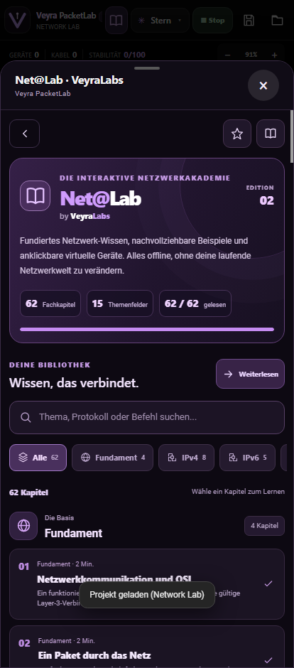
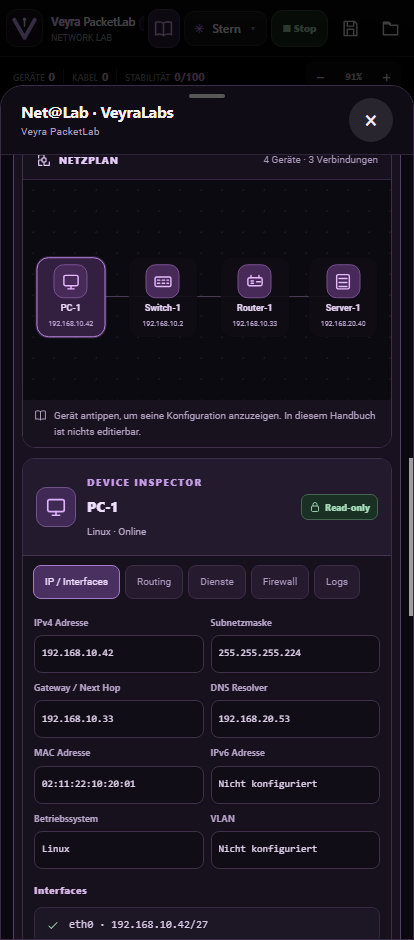
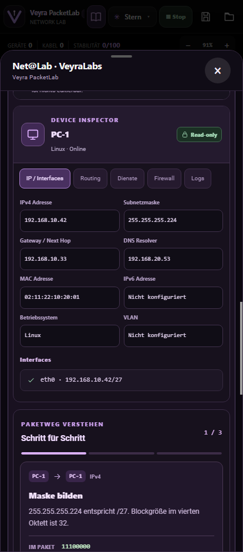
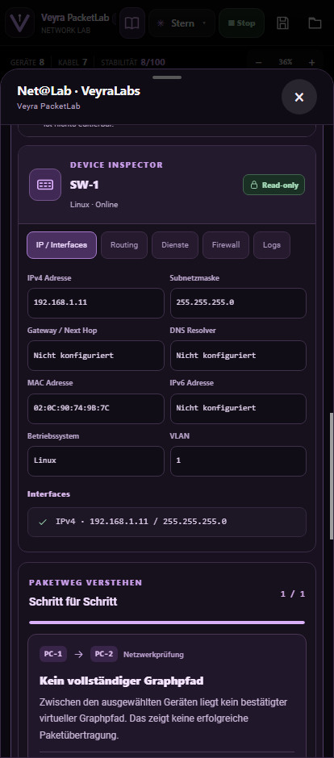

# Net@Lab V2 | VeyraLabs Interactive Network Academy

Net@Lab V2 ist die neue, lokale Lernansicht im bestehenden Veyra PacketLab (0.10.0). Sie ersetzt die alte Textlisten-Darstellung des Handbuchs. Die bestehenden 62 deutschsprachigen Kapitel und Lesezeichen werden übernommen, ohne ein neues Konto oder einen Online-Dienst vorauszusetzen.

## Aufbau

**Bibliothek**: Kapitel gruppiert nach 15 Fachbereichen, Suchfunktion über Titel, Kategorie und vollständigen Kapiteltext, Lesezeichen, Lesefortschritt und „Zuletzt gelesen“.

**Kapitelreader**: Lesbare Typografie, große Überschrift, Lernziel, gegliederter Originalfachtext, für das Thema aufbereitete Wissenskarten, ein eigenständiges Mini-Netzwerk, Schritt-für-Schritt-Paketweg, kopierbare Beispielbefehle, Merksatz, typische Fehler und verwandte Kapitel.

**Read-only Netzwerke**: Das Beispielnetz ist komplett vom aktuellen Lab getrennt. Geräte können für eine reine Anzeige der Konfiguration angetippt werden. Der Geräte-Inspector hat die Register „IP / Interfaces“, „Routing“, „Dienste“, „Firewall“ und „Logs“. Gezeigte Felder können nicht bearbeitet werden.

**Aktuelles Lab**: Über „Mein Lab“ wird der tatsächlich vorhandene virtuelle Graph des Nutzers schreibgeschützt dargestellt (bis zu acht Geräte in einer übersichtlichen Vorschau). Hier werden echte Daten aus dem aktuell geöffneten PacketLab-Modell übernommen, nicht aus dem Android-Host oder dem realen WLAN. Falls ein Route-Modell keinen Pfad bestätigen kann, wird keine erfolgreiche Übertragung erfunden.

**Paketweg**: Bei jedem Beispiel ein expliziter, lokal definierter didaktischer Ablauf mit mehreren Schritten. Der jeweils aktive Link wird im Netzwerkdiagramm hervorgehoben. Die Route kann vorwärts, rückwärts und von Anfang an betrachtet werden. Keine realen Pakete, keine Systemeingriffe.

## Didaktische Szenarien

Kontextbezogene Laborbeispiele für Gateway/Routing, CIDR/Subnetting, Ethernet-Switching, ARP, VLAN, DHCP, DNS, Firewall/ACL, Source-NAT/PAT, IPv6/Neighbor Discovery, WLAN/Access Point, HTTP/TLS, Linux, Windows, Cisco IOS und Security.

Die automatisierte Auswahl der Mini-Szenarien richtet sich zuerst nach dem Kapiteltitel, danach nach dem Fachbereich. So steht beispielsweise im IPv4-Subnetting-Kapitel eine /27-Adresse mit Netz- und Hostbereich, während beim Firewall-Kapitel Regeln und eine Firewall als tatsächlicher Zwischenknoten gezeigt werden. Für alle Kapitel gibt es ein Modell, eine technische Einordnung und einen relevanten Paketweg oder Diagnoseablauf.

## Projektstruktur

- app/src/main/assets/js/packetlab-v10-guide-data.js: rein statische Szenario- und Gerätebeispiele, Thema-zu-Szenario-Zuordnung, keine Änderungen an C.state.
- app/src/main/assets/js/packetlab-v10-guide.js: Kapitelreader, Bibliothek, Suche, Bookmarks, Demo-Inspector und Flow-Schrittsteuerung.
- app/src/main/assets/packetlab-v10-guide.css: eigenes OLED-Design mit mobilen Breakpoints, lesbarer Typografie und Read-only-Feldern.
- app/src/main/assets/js/packetlab-v09-book-data.js: bestehende 62 Originalkapitel, unverändert.

## Tests

Die neue mobile Chromium-Testdatei smoke_v10.cjs führt 21 Prüfungen aus, darunter Regressionstests des vorherigen PacketLab-Workflows. Zusätzlich werden weiterhin die 12 Core-Tests und 18 v0.6-Paketmodell-Tests ausgeführt.

Wichtige Qualitätsbedingungen: Kein OS-Befehl wird durch Net@Lab ausgeführt, keine echte Netzwerkverbindung aufgebaut, kein Geräteprofil im aktiven Lab überschrieben. Die Option „Mein Lab“ zeigt ausschließlich vorhandene virtuelle Informationen. Lesezeichen und Fortschritt bleiben über den vorhandenen lokalen Speicherschlüssel erhalten.

## Beispiele

