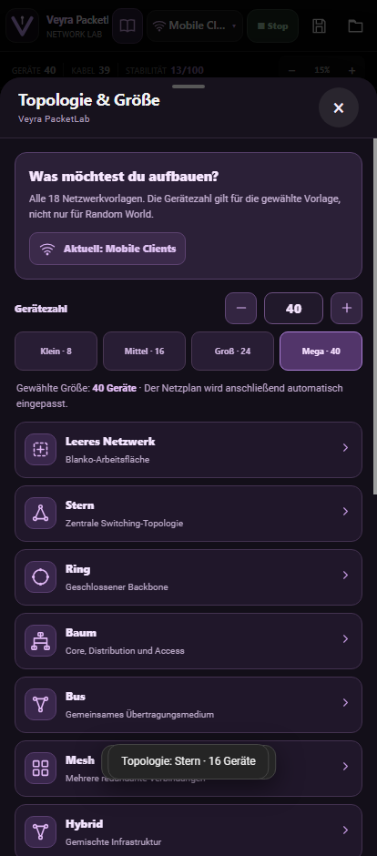

# PacketLab v0.11.1: Topology, Buildings and Icon Fixes

The Android network simulator retains its package ID, signing certificate, project formats, virtual terminals, Net@Lab and training features.

## Improvements

- Building mode is an opt-in feature at the very end of the devices list. It is disabled on startup and when loading an existing saved project. Floor controls remain hidden until requested.
- The top topology button now opens one picker containing all 18 types: Empty, Star, Ring, Tree, Bus, Mesh, Hybrid, Office, Campus, Datacenter, Dual WAN, Random, Smart Home, DMZ, Industrial, Mobile, Branch Office and School.
- Device count can be selected from 3 through 40 for every nonempty topology, with quick options for 8, 16, 24 and 40. Presets are regenerated or resized while maintaining their intended type. Canvas auto-fit runs after building the new topology.
- The top label displays the selected PacketLab preset, not the stale six-topology core kind, and survives save/load.
- Clean SVGs replace unstable glyphs in book, topology, building and studio controls. The version chip no longer overlaps the book. PacketLab Studio uses a settings glyph to avoid a duplicate lightning icon.

## Verification

40 headless mobile Chromium UI/regression tests, 12 original core tests, 18 network-model tests, no JavaScript errors, successful Gradle Android build.

