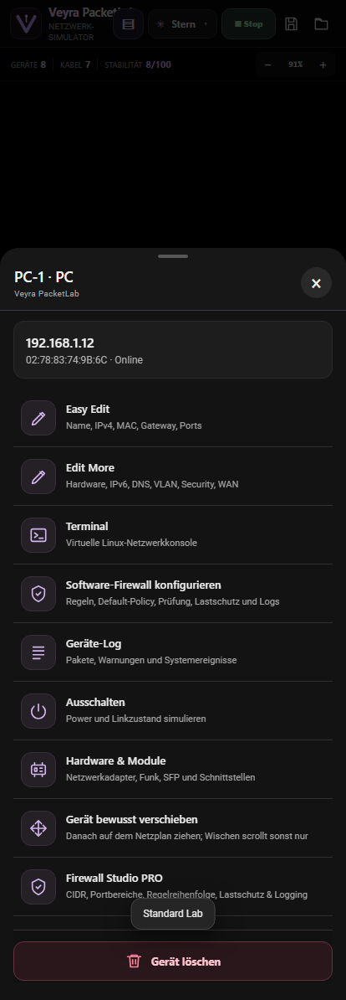

# PacketLab v0.7.1 — Device Menu UI Fix

This is a focused fix for the Android device action sheet reported in v0.7.0.

## Fixed

- Removed accidental large violet rectangles on the Hardware & Module, Move Device and Firewall Studio PRO actions.
- Removed the colored/purple border and filled background around the Software Firewall configuration item.
- Removed duplicate and placeholder icons. Each action now uses one matching icon and consistent two-column, native-looking OLED menu-row layout.
- Kept all existing buttons and behavior; the device configuration options, firewall rules, module manager and simulation engine are unchanged.

## Verification

- 27 mobile Chromium UI checks passed including a new structural regression test for all four corrected rows.
- The regression test verifies one icon per row, the correct CSS grid, a transparent row background and no left/top outline.
- 12 original core tests and 18 v0.6 simulation tests remain in the test suite.
- Android debug APK package: `ctrl.mietze.veyrapacketlab`, versionName `0.7.1`, versionCode `8`.
- Signed with the same Android debug certificate as v0.6.0/v0.7.0, intended for in-place updates.

This remains a local, educational network simulator without real cyberattacks or external network traffic. Existing `.pklab` world files are preserved.

