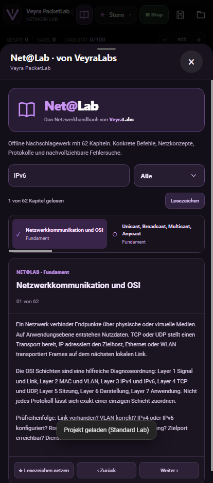

# PacketLab 0.9.0 — Network Lab, Training & Net@Lab

**Android app:** `ctrl.mietze.veyrapacketlab` (versionCode 10, versionName 0.9.0). Die vorherigen v0.8.0-.pklab-Netzwerke werden weiterhin unterstützt.

## Drei Arbeitsbereiche

**Network Lab:** Freier Netzwerkeditor mit allen bisherigen Topologien, Geräten, Terminal-, Paket- und Security-Funktionen. Nur hier sind die neuen Quick-Edit-Gesten, Building Agent und 2D-Gebäudeplanung verfügbar.

**Network Training Builder:** Eigene Level mit beliebig vielen prüfbaren Aufgaben, Sollwerten, Punkten und Hinweisen erstellen. Du kannst eine Baseline speichern, einen gewünschten Zielzustand konfigurieren und daraus zusätzliche Lernziele ableiten. Beim Speichern entstehen zwei Dateien: die editable `.pklab`-Projektdatei und die getrennte `.worklab`-Aufgabe.

**Network Lab Training:** Die `.worklab` stellt die Ausgangstopologie her und öffnet das Aufgabenbuch. Es kann direkt bewertet werden, Aufgaben lassen sich im Player nicht editieren. Eine Bearbeitungskopie kann über „Klon bearbeiten“ im Builder erstellt werden. Fertige Trainingsvorlagen sind vorhanden.

Alle drei Modi haben ihre eigene lokale Bibliothek und Verwaltung von gespeicherten Labs.

## Net@Lab · VeyraLabs

62 Originalkapitel mit Suche, Lesezeichen und Leseverlauf. Themen reichen von IPv4, IPv6, CIDR, VLAN, DHCP und DNS über Linux/Windows/Cisco/Android/iOS-Befehle bis zu Firewalls, Sicherheitsarchitektur und Fehlersuche. Das Buch wird offline mit der APK ausgeliefert.

## Oberfläche und Bedienung

- Nur eine Paketkonsole mit Quellen/Zielen und Veyra-Auswahldialogen. Die alte doppelte Toolbar und Android-Native-Popups werden nicht mehr präsentiert.
- Firewall-Editor vollständig als konfigurierbarer Bereich mit geordneten Regeln, CIDR, Protokollen, Portbereichen, Inspektion, Logging, Lastschutz und editierbaren Regeln.
- Device Inspector zeigt Geräteaktivität und Logs; Network Analyse zeigt aggregierte Fehler, Statistik, Topologieprobleme und Verbesserungsvorschläge.
- Angepasstes, moderates haptisches Feedback für Leiste, Aktionen und Schließen.
- Quick Edit auf freiem Canvas über lange Berührung, Gesten-Submenüs für Geräte, Repair, Smart Fix und Building Agent.
- Freigabegebundene Netzwerkentdeckung ausschließlich im Quick-Edit-Building-Agent: aktives WLAN, umliegende SSIDs und angebotene mDNS-Dienste über Android. Keine ungefragten Port-/Subnetzscans.
- 2D-Gebäudeeditor mit Räumen, Treppen, Fluren, verschiebbaren/resizierbaren Rechtecken und Etagenpfeilen.

## Sicherheits- und Funktionsgrenzen

Alle Netzwerke und Security-Szenarien der PacketLab-Simulation bleiben lokal virtuell. Die einzige bewusst reale Netzfunktion ist die separat freizugebende, optionale Android-WLAN/mDNS-Entdeckung. Nicht jedes Heimnetzgerät sendet mDNS, daher ist die Geräteliste ohne aktive Host-Scans nicht vollständig. Es sind weder vollständige Cisco-IOS-Images noch echte Betriebssystem-VMs enthalten. Die Dateigröße wird nicht künstlich mit nutzlosen Binärdaten aufgefüllt.

## Qualität

- Bisherige 12 Core-Tests und 18 v0.6-Netzwerkmodell-Tests.
- Mobile Chromium-End-to-End-Smoke-Suite: 13 Abläufe inklusive Worklab-Dualexport, spielbarer Training Player, Clone-to-Edit, Net@Lab, Firewall-Regeln, Diagnose, Quick Edit, Gebäude und Consent-Gating.
- Android Gradle Debug-Build und native Java-Kompilierung.

